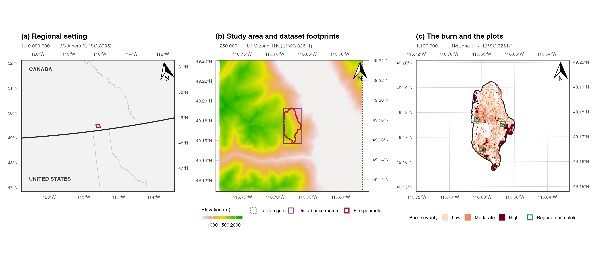
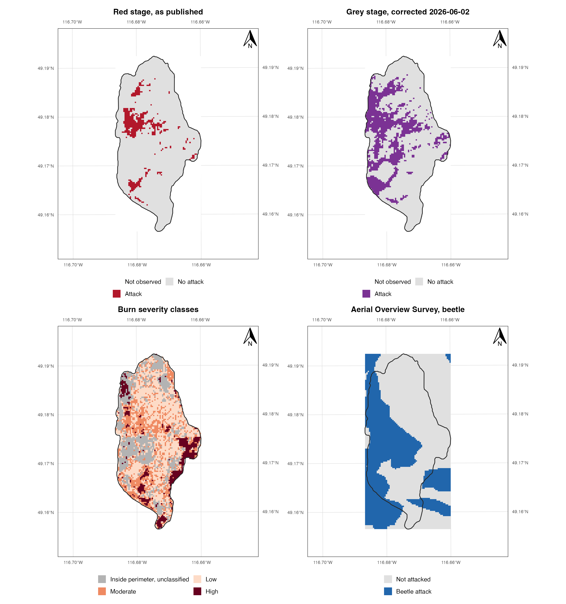
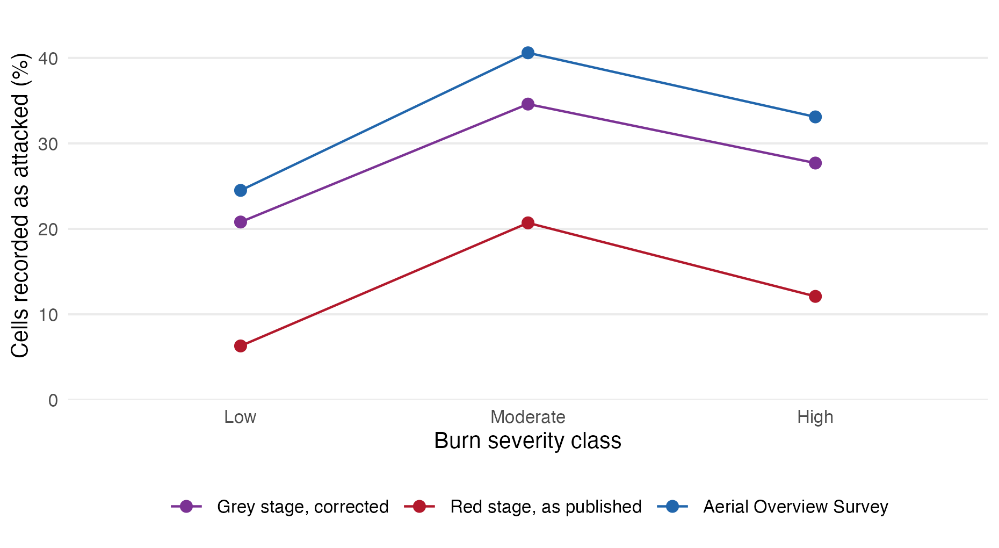
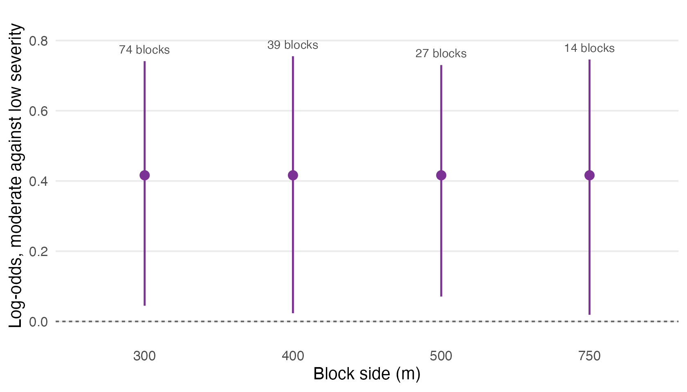
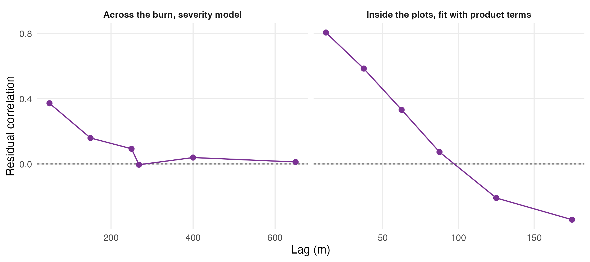
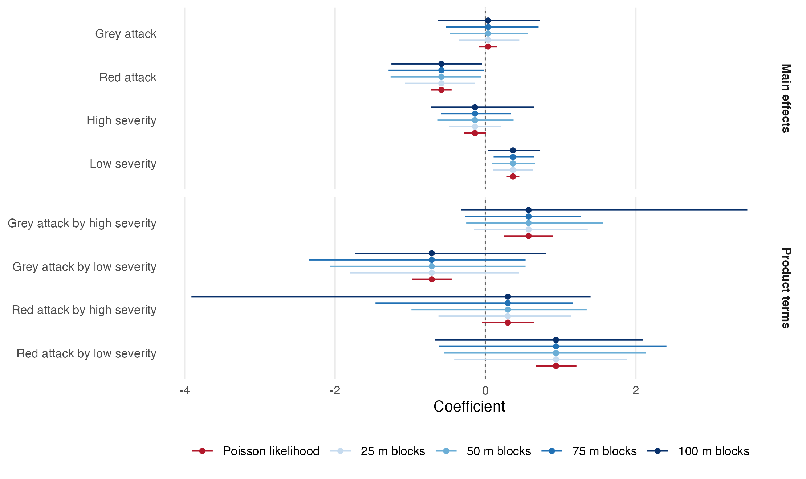

# Compound disturbance, additively modelled

*Testing whether beetle mortality and fire severity interact, in the landscape and in the model, Darkwoods Conservation Area, British Columbia*

Generated from the rendered manuscript by `03.outputs/build-readme.py`. Do not edit this file by hand: edit `01.manuscript/compound-disturbance-additively-modelled.qmd`, render, then rerun the script.

## Abstract

Compound disturbance is routinely described as an interaction and routinely modelled as a sum. This study separates them over a mountain pine beetle outbreak and the mixed-severity wildfire that followed it, in the southern Selkirk Mountains of British Columbia. Every beetle surface in the parent study descends from annual classifications clipped to the fire perimeter at source, and an unclipped provincial survey records attack outside the perimeter at a rate no lower than inside it, so any burned against unburned contrast measures the clip. Inside it, three records sharing no measurement pathway agree that attack peaks at moderate severity. The peak holds after conditioning on host cover and elevation, at 0.416 in log-odds against low severity; the fall at high severity does not. Refitting the parent study's point process model with beetle by fire product terms returns an emphatic interaction under the Poisson likelihood it is fitted with, and none under inference respecting the clustering that study documents. The coefficients are identical, the intervals 2.3 to 5.9 times wider, and not one of sixteen excludes zero; a cluster-robust sandwich agrees. These data cannot demonstrate a beetle by fire interaction; the confidence with which they appear to is the transferable result.

## Results

Every figure and table below is reproduced from the current render, in the order it appears in the manuscript.

### Table 1

*The annual classifications that date beetle attack, and the red-attack class code the grey-stage union is built from. The classification legend follows the provincial survey’s severity coding scheme, but the layers are Landsat classifications, not survey products. There is no file for the missing year, and the two most recent files carry none of the code at all, so the window that can be dated closes earlier than the file list suggests.*

<table>
<thead>
<tr>
<th align="right" width="204">Year</th>
<th align="right" width="1174">Cells carrying the code</th>
<th align="left" width="1021">In the dating window</th>
</tr>
</thead>
<tbody>
<tr><td align="right">2005</td><td align="right">534</td><td align="left">yes</td></tr>
<tr><td align="right">2006</td><td align="right">1530</td><td align="left">yes</td></tr>
<tr><td align="right">2007</td><td align="right">573</td><td align="left">yes</td></tr>
<tr><td align="right">2008</td><td align="right">0</td><td align="left"></td></tr>
<tr><td align="right">2009</td><td align="right">324</td><td align="left">yes</td></tr>
<tr><td align="right">2010</td><td align="right">0</td><td align="left"></td></tr>
<tr><td align="right">2011</td><td align="right">137</td><td align="left">yes</td></tr>
<tr><td align="right">2013</td><td align="right">0</td><td align="left"></td></tr>
<tr><td align="right">2014</td><td align="right">0</td><td align="left"></td></tr>
</tbody>
</table>

### Table 2

*Footprints of the local classified surfaces against the terrain grid. Every disturbance surface is confined to a rectangle of roughly eight square kilometres; the terrain grid covers thirty-four times that area.*

<table>
<thead>
<tr>
<th align="left" width="892">Surface</th>
<th align="right" width="123">Rows</th>
<th align="right" width="123">Cols</th>
<th align="right" width="246">Cell (m)</th>
<th align="right" width="308">Width (km)</th>
<th align="right" width="338">Height (km)</th>
<th align="right" width="369">Extent (km2)</th>
</tr>
</thead>
<tbody>
<tr><td align="left">Elevation, terrain grid</td><td align="right">695</td><td align="right">639</td><td align="right">25.11</td><td align="right">16.05</td><td align="right">17.45</td><td align="right">280.09</td></tr>
<tr><td align="left">Beetle red stage</td><td align="right">135</td><td align="right">66</td><td align="right">29.56</td><td align="right">1.95</td><td align="right">3.99</td><td align="right">7.78</td></tr>
<tr><td align="left">Beetle grey stage, corrected</td><td align="right">135</td><td align="right">66</td><td align="right">29.56</td><td align="right">1.95</td><td align="right">3.99</td><td align="right">7.78</td></tr>
<tr><td align="left">Beetle grey stage, deprecated</td><td align="right">135</td><td align="right">66</td><td align="right">29.56</td><td align="right">1.95</td><td align="right">3.99</td><td align="right">7.78</td></tr>
<tr><td align="left">Beetle continuous (spatstat)</td><td align="right">52</td><td align="right">47</td><td align="right">29.49</td><td align="right">1.39</td><td align="right">1.53</td><td align="right">2.13</td></tr>
<tr><td align="left">Burn severity, classified</td><td align="right">134</td><td align="right">66</td><td align="right">30.00</td><td align="right">1.98</td><td align="right">4.02</td><td align="right">7.96</td></tr>
<tr><td align="left">Beetle by fire intersection</td><td align="right">136</td><td align="right">67</td><td align="right">29.56</td><td align="right">1.98</td><td align="right">4.02</td><td align="right">7.96</td></tr>
</tbody>
</table>

### Table 3

*Decoding the classified burn severity raster against its own binary class masks, and against the fire perimeter. The integer codes are not in severity order. Code 16 falls inside the perimeter but in none of the three severity classes.*

<table>
<thead>
<tr>
<th align="left" width="1220">Class</th>
<th align="right" width="163">Code</th>
<th align="right" width="203">Cells</th>
<th align="right" width="814">Inside perimeter (%)</th>
</tr>
</thead>
<tbody>
<tr><td align="left">Outside perimeter</td><td align="right">0</td><td align="right">3514</td><td align="right">0.1</td></tr>
<tr><td align="left">Inside perimeter, unclassified</td><td align="right">16</td><td align="right">1268</td><td align="right">100.0</td></tr>
<tr><td align="left">Low</td><td align="right">32</td><td align="right">2144</td><td align="right">99.9</td></tr>
<tr><td align="left">Moderate</td><td align="right">34</td><td align="right">1383</td><td align="right">99.8</td></tr>
<tr><td align="left">High</td><td align="right">1</td><td align="right">535</td><td align="right">100.0</td></tr>
</tbody>
</table>

### Figure 1

*The study area at three nested scales. (a) Regional setting, with the Canada and United States border and provincial and state boundaries. (b) The terrain grid, the rectangle shared by every disturbance raster, and the fire perimeter inside it. (c) The burn itself with its classified severity and the three four-hectare regeneration plots that carry the point pattern of Section 5. Each panel is drawn to the stated representative fraction at the reproduction width given in the text, carries a true-north arrow, and is bounded by a WGS 84 graticule labelled on all four sides.*

### Table 4

*Where each beetle surface stops, against the fire perimeter, on the native beetle grid. The annual rasters carry nodata over almost the whole area outside the perimeter, and the two derived surfaces inherit it.*

<table>
<thead>
<tr>
<th align="left" width="735">Surface</th>
<th align="right" width="281">Cells present</th>
<th align="right" width="346">Inside perimeter</th>
<th align="right" width="368">Outside perimeter</th>
<th align="left" width="670">Note</th>
</tr>
</thead>
<tbody>
<tr><td align="left">Annual rasters, any data</td><td align="right">5487</td><td align="right">5477</td><td align="right">10</td><td align="left">nodata over the rest</td></tr>
<tr><td align="left">Corrected grey stage, 2005 to 2011</td><td align="right">1541</td><td align="right">1540</td><td align="right">1</td><td align="left">union of red-attack code 44</td></tr>
<tr><td align="left">Red stage, as published</td><td align="right">493</td><td align="right">493</td><td align="right">0</td><td align="left">substituted for a missing layer</td></tr>
</tbody>
</table>

### Table 5

*The two surfaces against the classified severity footprint. Grey attack is recorded throughout the perimeter; red attack is confined to the three classified severity classes and is absent from the cells inside the perimeter that no class mask claims.*

<table>
<thead>
<tr>
<th align="left" width="1079">Region</th>
<th align="right" width="135">Cells</th>
<th align="right" width="404">Annual data (%)</th>
<th align="right" width="404">Grey attack (%)</th>
<th align="right" width="378">Red attack (%)</th>
</tr>
</thead>
<tbody>
<tr><td align="left">Outside the fire perimeter</td><td align="right">3429</td><td align="right">0.3</td><td align="right">0.0</td><td align="right">0.0</td></tr>
<tr><td align="left">Inside perimeter, unclassified severity</td><td align="right">1367</td><td align="right">99.7</td><td align="right">33.1</td><td align="right">0.0</td></tr>
<tr><td align="left">Inside the classified severity footprint</td><td align="right">4136</td><td align="right">99.5</td><td align="right">26.3</td><td align="right">11.9</td></tr>
</tbody>
</table>

### Table 6

*The two local surfaces against the independent Aerial Overview Survey, by burn severity class. Local rates are computed only over cells the annual rasters actually observe. The survey finds no shortage of beetle attack outside the burn, and neither does the small observed sliver of the local data.*

<table>
<thead>
<tr>
<th align="left" width="774">Class</th>
<th align="right" width="129">Cells</th>
<th align="right" width="310">Observed (%)</th>
<th align="right" width="206">Observed</th>
<th align="right" width="206">Grey (%)</th>
<th align="right" width="181">Red (%)</th>
<th align="right" width="258">Survey (%)</th>
<th align="right" width="335">Elevation (m)</th>
</tr>
</thead>
<tbody>
<tr><td align="left">Outside perimeter</td><td align="right">3429</td><td align="right">0.3</td><td align="right">10</td><td align="right">10.0</td><td align="right">0.0</td><td align="right">40.4</td><td align="right">1190</td></tr>
<tr><td align="left">Inside perimeter, unclassified</td><td align="right">1367</td><td align="right">99.7</td><td align="right">1363</td><td align="right">33.2</td><td align="right">0.0</td><td align="right">51.8</td><td align="right">1442</td></tr>
<tr><td align="left">Low</td><td align="right">2158</td><td align="right">100.0</td><td align="right">2158</td><td align="right">20.8</td><td align="right">6.3</td><td align="right">24.5</td><td align="right">1367</td></tr>
<tr><td align="left">Moderate</td><td align="right">1403</td><td align="right">100.0</td><td align="right">1403</td><td align="right">34.6</td><td align="right">20.7</td><td align="right">40.6</td><td align="right">1449</td></tr>
<tr><td align="left">High</td><td align="right">553</td><td align="right">100.0</td><td align="right">553</td><td align="right">27.7</td><td align="right">12.1</td><td align="right">33.1</td><td align="right">1408</td></tr>
</tbody>
</table>

### Figure 2

*The clip, mapped, at 1:50 000 in UTM zone 11N (EPSG:32611) with a WGS 84 graticule labelled on all four sides. Top left, the published red-stage surface, which stops at the classified burn. Top right, the corrected grey-stage union, which reaches the fire perimeter and stops there. Bottom left, the burn severity classes. Bottom right, the independent Aerial Overview Survey, which does not stop at anything. The unburned ground in the two upper panels is empty because it was never observed, not because it was never attacked.*

### Figure 3

*Beetle attack across burn severity within the fire perimeter, in the two local surfaces and in the independent survey. The three records share no common measurement pathway and all three peak at moderate severity. Point labels give the number of cells in each class.*

### Table 7

*The same three records as counts and rates, with the cells and the mean elevation of each class. The figure carries the shape; this table carries the numbers the elevation argument below rests on.*

<table>
<thead>
<tr>
<th align="left" width="376">Class</th>
<th align="right" width="235">Cells</th>
<th align="right" width="376">Grey (%)</th>
<th align="right" width="329">Red (%)</th>
<th align="right" width="471">Survey (%)</th>
<th align="right" width="612">Elevation (m)</th>
</tr>
</thead>
<tbody>
<tr><td align="left">Low</td><td align="right">2158</td><td align="right">20.8</td><td align="right">6.3</td><td align="right">24.5</td><td align="right">1367</td></tr>
<tr><td align="left">Moderate</td><td align="right">1403</td><td align="right">34.6</td><td align="right">20.7</td><td align="right">40.6</td><td align="right">1449</td></tr>
<tr><td align="left">High</td><td align="right">553</td><td align="right">27.7</td><td align="right">12.1</td><td align="right">33.1</td><td align="right">1408</td></tr>
</tbody>
</table>

### Table 8

*Attack, host cover and elevation by burn severity class, and the crude contrast between stands carrying lodgepole and stands without it.*

<table>
<thead>
<tr>
<th align="left" width="788">Stratum</th>
<th align="right" width="188">Cells</th>
<th align="right" width="450">Attacked (%)</th>
<th align="right" width="488">Lodgepole (%)</th>
<th align="right" width="488">Elevation (m)</th>
</tr>
</thead>
<tbody>
<tr><td align="left">By burn severity</td><td align="right"></td><td align="right"></td><td align="right"></td><td align="right"></td></tr>
<tr><td align="left">High severity</td><td align="right">553</td><td align="right">27.7</td><td align="right">18.1</td><td align="right">1408</td></tr>
<tr><td align="left">Low severity</td><td align="right">2158</td><td align="right">20.8</td><td align="right">17.2</td><td align="right">1367</td></tr>
<tr><td align="left">Moderate severity</td><td align="right">1403</td><td align="right">34.6</td><td align="right">24.4</td><td align="right">1449</td></tr>
<tr><td align="left">Unclassified severity</td><td align="right">1299</td><td align="right">33.2</td><td align="right">20.2</td><td align="right">1442</td></tr>
<tr><td align="left">By host presence</td><td align="right"></td><td align="right"></td><td align="right"></td><td align="right"></td></tr>
<tr><td align="left">Lodgepole absent</td><td align="right">1973</td><td align="right">15.3</td><td align="right">0.0</td><td align="right">1258</td></tr>
<tr><td align="left">Lodgepole present</td><td align="right">3440</td><td align="right">35.3</td><td align="right">31.3</td><td align="right">1498</td></tr>
</tbody>
</table>

### Table 9

*Burn severity coefficients on grey-stage attack, as log-odds against low severity, crude and then conditioned on host presence and elevation. Intervals are spatial block bootstrap percentiles at 500 m blocks. An interval that excludes zero is marked.*

<table>
<thead>
<tr>
<th align="left" width="651">Model</th>
<th align="left" width="377">Term</th>
<th align="right" width="514">Estimate</th>
<th align="left" width="480">Interval</th>
<th align="left" width="377"></th>
</tr>
</thead>
<tbody>
<tr><td align="left">Severity only</td><td align="left">sevModerate</td><td align="right">0.705</td><td align="left">[0.337, 1.009]</td><td align="left">clears zero</td></tr>
<tr><td align="left">sevHigh</td><td align="left">0.378</td><td align="right">[-0.368, 1.185]</td><td align="left"></td><td align="left"></td></tr>
<tr><td align="left">sevUnclassified</td><td align="left">0.639</td><td align="right">[-0.072, 1.139]</td><td align="left"></td><td align="left"></td></tr>
<tr><td align="left">+ host + elevation</td><td align="left">sevModerate</td><td align="right">0.416</td><td align="left">[0.071, 0.730]</td><td align="left">clears zero</td></tr>
<tr><td align="left">sevHigh</td><td align="left">0.286</td><td align="right">[-0.395, 1.052]</td><td align="left"></td><td align="left"></td></tr>
<tr><td align="left">sevUnclassified</td><td align="left">0.328</td><td align="right">[-0.296, 0.868]</td><td align="left"></td><td align="left"></td></tr>
<tr><td align="left">host</td><td align="left">0.186</td><td align="right">[-0.510, 0.939]</td><td align="left"></td><td align="left"></td></tr>
<tr><td align="left">ec</td><td align="left">0.424</td><td align="right">[0.252, 0.684]</td><td align="left">clears zero</td><td align="left"></td></tr>
<tr><td align="left">+ elevation squared</td><td align="left">sevModerate</td><td align="right">0.403</td><td align="left">[0.032, 0.728]</td><td align="left">clears zero</td></tr>
<tr><td align="left">sevHigh</td><td align="left">0.277</td><td align="right">[-0.377, 1.062]</td><td align="left"></td><td align="left"></td></tr>
<tr><td align="left">sevUnclassified</td><td align="left">0.306</td><td align="right">[-0.320, 0.857]</td><td align="left"></td><td align="left"></td></tr>
<tr><td align="left">host</td><td align="left">0.196</td><td align="right">[-0.503, 0.977]</td><td align="left"></td><td align="left"></td></tr>
<tr><td align="left">ec</td><td align="left">0.415</td><td align="right">[0.236, 0.644]</td><td align="left">clears zero</td><td align="left"></td></tr>
<tr><td align="left">I(ec^2)</td><td align="left">0.023</td><td align="right">[-0.047, 0.116]</td><td align="left"></td><td align="left"></td></tr>
</tbody>
</table>

### Table 10

*The elevation term inside the burn, against the landscape-scale form the companion study reports. The quadratic term is negligible and its implied optimum falls far outside the elevation range the burn spans, so within this clip the relationship is monotone.*

<table>
<thead>
<tr>
<th align="left" width="1574">Quantity</th>
<th align="left" width="826">Value</th>
</tr>
</thead>
<tbody>
<tr><td align="left">Elevation range spanned by the burn</td><td align="left">872 to 1747 m</td></tr>
<tr><td align="left">Linear elevation, log-odds per 100 m</td><td align="left">0.424 [0.252, 0.684]</td></tr>
<tr><td align="left">Quadratic elevation term</td><td align="left">0.023 [-0.047, 0.116]</td></tr>
<tr><td align="left">Implied optimum of the fitted quadratic</td><td align="left">503 m</td></tr>
<tr><td align="left">Landscape-scale optimum, companion study</td><td align="left">about 1,430 m</td></tr>
</tbody>
</table>

### Figure 4

*The moderate-against-low severity coefficient under block bootstraps of increasing block size. The estimate is fixed; only the interval changes, and the number of blocks each size affords is printed above it. The extent caps the largest usable block, not the conclusion.*

### Table 11

*The block sweep as numbers: the moderate-against-low coefficient, the interval it carries at each block size, and the blocks each size affords. The figure shows that only the interval moves; this table gives the bounds it moves between.*

<table>
<thead>
<tr>
<th align="right" width="634">Block side (m)</th>
<th align="right" width="272">Blocks</th>
<th align="right" width="362">Estimate</th>
<th align="left" width="634">Interval</th>
<th align="left" width="498"></th>
</tr>
</thead>
<tbody>
<tr><td align="right">300</td><td align="right">74</td><td align="right">0.416</td><td align="left">[0.045, 0.741]</td><td align="left">clears zero</td></tr>
<tr><td align="right">400</td><td align="right">39</td><td align="right">0.416</td><td align="left">[0.023, 0.755]</td><td align="left">clears zero</td></tr>
<tr><td align="right">500</td><td align="right">27</td><td align="right">0.416</td><td align="left">[0.071, 0.730]</td><td align="left">clears zero</td></tr>
<tr><td align="right">750</td><td align="right">14</td><td align="right">0.416</td><td align="left">[0.019, 0.746]</td><td align="left">clears zero</td></tr>
</tbody>
</table>

### Table 12

*Residual correlogram of the conditioned model across the burn, by distance lag. This is the left panel of Figure 5 at the precision the block-size argument uses.*

<table>
<thead>
<tr>
<th align="left" width="945">Lag (m)</th>
<th align="right" width="1455">Residual correlation</th>
</tr>
</thead>
<tbody>
<tr><td align="left">(0,100]</td><td align="right">0.394</td></tr>
<tr><td align="left">(100,200]</td><td align="right">0.206</td></tr>
<tr><td align="left">(200,300]</td><td align="right">0.101</td></tr>
<tr><td align="left">(300,500]</td><td align="right">0.057</td></tr>
<tr><td align="left">(500,800]</td><td align="right">0.049</td></tr>
<tr><td align="left">(800,1.2e+03]</td><td align="right">0.020</td></tr>
<tr><td align="left">(1.2e+03,Inf]</td><td align="right">-0.055</td></tr>
</tbody>
</table>

### Table 13

*The published additive trend, as reported by the parent study’s final refit and as recomputed here from the same rasters, with the standard errors each carries. The comparison is the licence for everything that follows: a product term added to a model that did not reproduce would test nothing. The standard-error columns show that the published uncertainty is the naive Poisson uncertainty, which is the premise of Section 5.5.*

<table>
<thead>
<tr>
<th align="left" width="352">Term</th>
<th align="right" width="288">Published</th>
<th align="right" width="320">Recomputed</th>
<th align="right" width="384">Published SE</th>
<th align="right" width="320">Poisson SE</th>
<th align="right" width="320">Difference</th>
<th align="right" width="416">SE difference</th>
</tr>
</thead>
<tbody>
<tr><td align="left">(Intercept)</td><td align="right">-4.2504</td><td align="right">-4.2504</td><td align="right">0.2099</td><td align="right">0.2099</td><td align="right">0</td><td align="right">0</td></tr>
<tr><td align="left">SS_dist</td><td align="right">-0.0121</td><td align="right">-0.0121</td><td align="right">0.0005</td><td align="right">0.0005</td><td align="right">0</td><td align="right">0</td></tr>
<tr><td align="left">Aspect</td><td align="right">0.5538</td><td align="right">0.5538</td><td align="right">0.0427</td><td align="right">0.0427</td><td align="right">0</td><td align="right">0</td></tr>
<tr><td align="left">RIX</td><td align="right">0.6262</td><td align="right">0.6262</td><td align="right">0.3064</td><td align="right">0.3064</td><td align="right">0</td><td align="right">0</td></tr>
<tr><td align="left">Wind</td><td align="right">0.2721</td><td align="right">0.2721</td><td align="right">0.0327</td><td align="right">0.0327</td><td align="right">0</td><td align="right">0</td></tr>
<tr><td align="left">MPB_G</td><td align="right">-0.0007</td><td align="right">-0.0007</td><td align="right">0.0513</td><td align="right">0.0513</td><td align="right">0</td><td align="right">0</td></tr>
<tr><td align="left">MPB_R</td><td align="right">-0.3095</td><td align="right">-0.3095</td><td align="right">0.0555</td><td align="right">0.0555</td><td align="right">0</td><td align="right">0</td></tr>
<tr><td align="left">Fire_H</td><td align="right">0.2071</td><td align="right">0.2071</td><td align="right">0.0574</td><td align="right">0.0574</td><td align="right">0</td><td align="right">0</td></tr>
<tr><td align="left">Fire_L</td><td align="right">0.3952</td><td align="right">0.3952</td><td align="right">0.0379</td><td align="right">0.0379</td><td align="right">0</td><td align="right">0</td></tr>
</tbody>
</table>

### Table 14

*Quadrature points inside the three plots, by burn severity class and beetle surface. The published fit’s reference category is the union of the two rows that carry no severity indicator, so it pools moderate severity with unburned and unclassified ground.*

<table>
<thead>
<tr>
<th align="left" width="706">Class</th>
<th align="right" width="400">Quadrature points</th>
<th align="right" width="212">Area (ha)</th>
<th align="right" width="306">Grey attacked</th>
<th align="right" width="282">Red attacked</th>
<th align="left" width="494">In reference category</th>
</tr>
</thead>
<tbody>
<tr><td align="left">Low</td><td align="right">323</td><td align="right">3.23</td><td align="right">70</td><td align="right">54</td><td align="left"></td></tr>
<tr><td align="left">Moderate</td><td align="right">553</td><td align="right">5.53</td><td align="right">270</td><td align="right">218</td><td align="left">yes</td></tr>
<tr><td align="left">High</td><td align="right">288</td><td align="right">2.88</td><td align="right">68</td><td align="right">54</td><td align="left"></td></tr>
<tr><td align="left">Inside perimeter, unclassified</td><td align="right">118</td><td align="right">1.18</td><td align="right">31</td><td align="right">0</td><td align="left">yes</td></tr>
</tbody>
</table>

### Table 15

*The additive trend as published, and the same trend with the four beetle by fire product terms added. Intervals are the naive Poisson intervals the published likelihood implies, and terms excluding zero on those intervals are marked. Read this way the interaction is emphatic; Section 5.5 reads it the other way.*

<table>
<thead>
<tr>
<th align="left" width="384">Term</th>
<th align="left" width="576">Model</th>
<th align="right" width="512">Estimate</th>
<th align="left" width="512">Interval</th>
<th align="left" width="416"></th>
</tr>
</thead>
<tbody>
<tr><td align="left">SS_dist</td><td align="left">As published</td><td align="right">-0.012</td><td align="left">[-0.013, -0.011]</td><td align="left">excludes zero</td></tr>
<tr><td align="left">Aspect</td><td align="left">0.554</td><td align="right">[0.470, 0.637]</td><td align="left">excludes zero</td><td align="left"></td></tr>
<tr><td align="left">RIX</td><td align="left">0.626</td><td align="right">[0.026, 1.227]</td><td align="left">excludes zero</td><td align="left"></td></tr>
<tr><td align="left">Wind</td><td align="left">0.272</td><td align="right">[0.208, 0.336]</td><td align="left">excludes zero</td><td align="left"></td></tr>
<tr><td align="left">MPB_G</td><td align="left">-0.001</td><td align="right">[-0.101, 0.100]</td><td align="left"></td><td align="left"></td></tr>
<tr><td align="left">MPB_R</td><td align="left">-0.309</td><td align="right">[-0.418, -0.201]</td><td align="left">excludes zero</td><td align="left"></td></tr>
<tr><td align="left">Fire_H</td><td align="left">0.207</td><td align="right">[0.095, 0.320]</td><td align="left">excludes zero</td><td align="left"></td></tr>
<tr><td align="left">Fire_L</td><td align="left">0.395</td><td align="right">[0.321, 0.470]</td><td align="left">excludes zero</td><td align="left"></td></tr>
<tr><td align="left">SS_dist</td><td align="left">With product terms</td><td align="right">-0.011</td><td align="left">[-0.012, -0.010]</td><td align="left">excludes zero</td></tr>
<tr><td align="left">Aspect</td><td align="left">0.648</td><td align="right">[0.555, 0.741]</td><td align="left">excludes zero</td><td align="left"></td></tr>
<tr><td align="left">RIX</td><td align="left">0.526</td><td align="right">[-0.090, 1.141]</td><td align="left"></td><td align="left"></td></tr>
<tr><td align="left">Wind</td><td align="left">0.306</td><td align="right">[0.239, 0.374]</td><td align="left">excludes zero</td><td align="left"></td></tr>
<tr><td align="left">MPB_G</td><td align="left">0.036</td><td align="right">[-0.086, 0.158]</td><td align="left"></td><td align="left"></td></tr>
<tr><td align="left">MPB_R</td><td align="left">-0.586</td><td align="right">[-0.722, -0.450]</td><td align="left">excludes zero</td><td align="left"></td></tr>
<tr><td align="left">Fire_H</td><td align="left">-0.139</td><td align="right">[-0.285, 0.007]</td><td align="left"></td><td align="left"></td></tr>
<tr><td align="left">Fire_L</td><td align="left">0.367</td><td align="right">[0.283, 0.451]</td><td align="left">excludes zero</td><td align="left"></td></tr>
<tr><td align="left">MPB_G:Fire_H</td><td align="left">0.574</td><td align="right">[0.251, 0.897]</td><td align="left">excludes zero</td><td align="left"></td></tr>
<tr><td align="left">MPB_G:Fire_L</td><td align="left">-0.714</td><td align="right">[-0.979, -0.449]</td><td align="left">excludes zero</td><td align="left"></td></tr>
<tr><td align="left">MPB_R:Fire_H</td><td align="left">0.298</td><td align="right">[-0.046, 0.643]</td><td align="left"></td><td align="left"></td></tr>
<tr><td align="left">MPB_R:Fire_L</td><td align="left">0.939</td><td align="right">[0.667, 1.211]</td><td align="left">excludes zero</td><td align="left"></td></tr>
</tbody>
</table>

### Figure 5

*Residual dependence at the two scales the study works at. Left, the conditioned model of Section 4 across the burn, where dependence has largely decayed by 500 m. Right, the fit with product terms over the quadrature points inside the regeneration plots, where it has decayed by about 100 m. The two panels are the same obstacle two orders of magnitude apart, and each sets the block sizes tried at its own scale.*

### Table 16

*Residual correlogram of the fit with product terms, over the quadrature points inside the plots. This is the right panel of Figure 5 at the precision that sets the block sizes tried below.*

<table>
<thead>
<tr>
<th align="left" width="745">Lag (m)</th>
<th align="right" width="1655">Residual correlation</th>
</tr>
</thead>
<tbody>
<tr><td align="left">(0,25]</td><td align="right">0.806</td></tr>
<tr><td align="left">(25,50]</td><td align="right">0.585</td></tr>
<tr><td align="left">(50,75]</td><td align="right">0.332</td></tr>
<tr><td align="left">(75,100]</td><td align="right">0.073</td></tr>
<tr><td align="left">(100,150]</td><td align="right">-0.209</td></tr>
<tr><td align="left">(150,200]</td><td align="right">-0.342</td></tr>
<tr><td align="left">(200,Inf]</td><td align="right">-0.014</td></tr>
</tbody>
</table>

### Figure 6

*The four product terms and the main effects they modify, under the Poisson likelihood the published model is fitted with and under a spatial block bootstrap across block sizes spanning the residual range. The estimate is the same in every case; only the interval changes. Three of the four product terms exclude zero under the Poisson likelihood and none excludes it at any block size.*

### Table 17

*The same intervals as numbers, with the count of bootstrap draws that identified each term. A term short of the full count was unestimable in some resample, because the blocks carrying its cells were not drawn; its interval is then a percentile over the draws that did identify it and is read accordingly.*

<table>
<thead>
<tr>
<th align="right" width="425">Block side (m)</th>
<th align="right" width="182">Blocks</th>
<th align="left" width="486">Term</th>
<th align="right" width="273">Estimate</th>
<th align="left" width="456">Interval</th>
<th align="right" width="273">Draws</th>
<th align="left" width="304"></th>
</tr>
</thead>
<tbody>
<tr><td align="right">25</td><td align="right">234</td><td align="left">MPB_G</td><td align="right">0.036</td><td align="left">[-0.351, 0.451]</td><td align="right">2000/2000</td><td align="left">spans zero</td></tr>
<tr><td align="right">MPB_R</td><td align="right">-0.586</td><td align="left">[-1.070, -0.136]</td><td align="right">2000/2000</td><td align="left">clears zero</td><td align="right"></td><td align="left"></td></tr>
<tr><td align="right">Fire_H</td><td align="right">-0.139</td><td align="left">[-0.479, 0.208]</td><td align="right">2000/2000</td><td align="left">spans zero</td><td align="right"></td><td align="left"></td></tr>
<tr><td align="right">Fire_L</td><td align="right">0.367</td><td align="left">[0.099, 0.628]</td><td align="right">2000/2000</td><td align="left">clears zero</td><td align="right"></td><td align="left"></td></tr>
<tr><td align="right">MPB_G:Fire_H</td><td align="right">0.574</td><td align="left">[-0.154, 1.361]</td><td align="right">2000/2000</td><td align="left">spans zero</td><td align="right"></td><td align="left"></td></tr>
<tr><td align="right">MPB_G:Fire_L</td><td align="right">-0.714</td><td align="left">[-1.798, 0.449]</td><td align="right">2000/2000</td><td align="left">spans zero</td><td align="right"></td><td align="left"></td></tr>
<tr><td align="right">MPB_R:Fire_H</td><td align="right">0.298</td><td align="left">[-0.624, 1.137]</td><td align="right">1998/2000</td><td align="left">spans zero</td><td align="right"></td><td align="left"></td></tr>
<tr><td align="right">MPB_R:Fire_L</td><td align="right">0.939</td><td align="left">[-0.414, 1.881]</td><td align="right">2000/2000</td><td align="left">spans zero</td><td align="right"></td><td align="left"></td></tr>
<tr><td align="right">50</td><td align="right">70</td><td align="left">MPB_G</td><td align="right">0.036</td><td align="left">[-0.472, 0.564]</td><td align="right">2000/2000</td><td align="left">spans zero</td></tr>
<tr><td align="right">MPB_R</td><td align="right">-0.586</td><td align="left">[-1.261, -0.059]</td><td align="right">2000/2000</td><td align="left">clears zero</td><td align="right"></td><td align="left"></td></tr>
<tr><td align="right">Fire_H</td><td align="right">-0.139</td><td align="left">[-0.635, 0.374]</td><td align="right">2000/2000</td><td align="left">spans zero</td><td align="right"></td><td align="left"></td></tr>
<tr><td align="right">Fire_L</td><td align="right">0.367</td><td align="left">[0.084, 0.662]</td><td align="right">2000/2000</td><td align="left">clears zero</td><td align="right"></td><td align="left"></td></tr>
<tr><td align="right">MPB_G:Fire_H</td><td align="right">0.574</td><td align="left">[-0.255, 1.564]</td><td align="right">2000/2000</td><td align="left">spans zero</td><td align="right"></td><td align="left"></td></tr>
<tr><td align="right">MPB_G:Fire_L</td><td align="right">-0.714</td><td align="left">[-2.065, 0.534]</td><td align="right">2000/2000</td><td align="left">spans zero</td><td align="right"></td><td align="left"></td></tr>
<tr><td align="right">MPB_R:Fire_H</td><td align="right">0.298</td><td align="left">[-0.984, 1.347]</td><td align="right">1999/2000</td><td align="left">spans zero</td><td align="right"></td><td align="left"></td></tr>
<tr><td align="right">MPB_R:Fire_L</td><td align="right">0.939</td><td align="left">[-0.549, 2.132]</td><td align="right">2000/2000</td><td align="left">spans zero</td><td align="right"></td><td align="left"></td></tr>
<tr><td align="right">75</td><td align="right">36</td><td align="left">MPB_G</td><td align="right">0.036</td><td align="left">[-0.525, 0.707]</td><td align="right">2000/2000</td><td align="left">spans zero</td></tr>
<tr><td align="right">MPB_R</td><td align="right">-0.586</td><td align="left">[-1.288, -0.018]</td><td align="right">2000/2000</td><td align="left">clears zero</td><td align="right"></td><td align="left"></td></tr>
<tr><td align="right">Fire_H</td><td align="right">-0.139</td><td align="left">[-0.592, 0.340]</td><td align="right">2000/2000</td><td align="left">spans zero</td><td align="right"></td><td align="left"></td></tr>
<tr><td align="right">Fire_L</td><td align="right">0.367</td><td align="left">[0.109, 0.647]</td><td align="right">2000/2000</td><td align="left">clears zero</td><td align="right"></td><td align="left"></td></tr>
<tr><td align="right">MPB_G:Fire_H</td><td align="right">0.574</td><td align="left">[-0.268, 1.266]</td><td align="right">1999/2000</td><td align="left">spans zero</td><td align="right"></td><td align="left"></td></tr>
<tr><td align="right">MPB_G:Fire_L</td><td align="right">-0.714</td><td align="left">[-2.343, 0.534]</td><td align="right">2000/2000</td><td align="left">spans zero</td><td align="right"></td><td align="left"></td></tr>
<tr><td align="right">MPB_R:Fire_H</td><td align="right">0.298</td><td align="left">[-1.462, 1.159]</td><td align="right">1906/2000</td><td align="left">spans zero</td><td align="right"></td><td align="left"></td></tr>
<tr><td align="right">MPB_R:Fire_L</td><td align="right">0.939</td><td align="left">[-0.620, 2.408]</td><td align="right">2000/2000</td><td align="left">spans zero</td><td align="right"></td><td align="left"></td></tr>
<tr><td align="right">100</td><td align="right">27</td><td align="left">MPB_G</td><td align="right">0.036</td><td align="left">[-0.630, 0.728]</td><td align="right">2000/2000</td><td align="left">spans zero</td></tr>
<tr><td align="right">MPB_R</td><td align="right">-0.586</td><td align="left">[-1.250, -0.045]</td><td align="right">2000/2000</td><td align="left">clears zero</td><td align="right"></td><td align="left"></td></tr>
<tr><td align="right">Fire_H</td><td align="right">-0.139</td><td align="left">[-0.722, 0.647]</td><td align="right">2000/2000</td><td align="left">spans zero</td><td align="right"></td><td align="left"></td></tr>
<tr><td align="right">Fire_L</td><td align="right">0.367</td><td align="left">[0.030, 0.729]</td><td align="right">2000/2000</td><td align="left">clears zero</td><td align="right"></td><td align="left"></td></tr>
<tr><td align="right">MPB_G:Fire_H</td><td align="right">0.574</td><td align="left">[-0.323, 3.484]</td><td align="right">2000/2000</td><td align="left">spans zero</td><td align="right"></td><td align="left"></td></tr>
<tr><td align="right">MPB_G:Fire_L</td><td align="right">-0.714</td><td align="left">[-1.737, 0.808]</td><td align="right">2000/2000</td><td align="left">spans zero</td><td align="right"></td><td align="left"></td></tr>
<tr><td align="right">MPB_R:Fire_H</td><td align="right">0.298</td><td align="left">[-3.909, 1.399]</td><td align="right">1965/2000</td><td align="left">spans zero</td><td align="right"></td><td align="left"></td></tr>
<tr><td align="right">MPB_R:Fire_L</td><td align="right">0.939</td><td align="left">[-0.670, 2.091]</td><td align="right">1996/2000</td><td align="left">spans zero</td><td align="right"></td><td align="left"></td></tr>
</tbody>
</table>

### Table 18

*A second variance estimate, independent of the bootstrap. Standard errors for the fit with product terms under the naive Poisson likelihood and under a cluster-robust sandwich clustered on the same spatial blocks, with the ratio between them. The bootstrap resamples blocks; the sandwich sums scores within them. The two answer the same question by different routes.*

<table>
<thead>
<tr>
<th align="right" width="946">Block side (m)</th>
<th align="left" width="372">Term</th>
<th align="right" width="338">Poisson SE</th>
<th align="right" width="575">Cluster-robust SE</th>
<th align="right" width="169">Ratio</th>
</tr>
</thead>
<tbody>
<tr><td align="right">75</td><td align="left">Grey attack</td><td align="right">0.062</td><td align="right">0.257</td><td align="right">4.1</td></tr>
<tr><td align="right">Red attack</td><td align="left">0.069</td><td align="right">0.281</td><td align="right">4.0</td><td align="right"></td></tr>
<tr><td align="right">High severity</td><td align="left">0.075</td><td align="right">0.202</td><td align="right">2.7</td><td align="right"></td></tr>
<tr><td align="right">Low severity</td><td align="left">0.043</td><td align="right">0.135</td><td align="right">3.1</td><td align="right"></td></tr>
<tr><td align="right">Grey attack by high severity</td><td align="left">0.165</td><td align="right">0.297</td><td align="right">1.8</td><td align="right"></td></tr>
<tr><td align="right">Grey attack by low severity</td><td align="left">0.135</td><td align="right">0.743</td><td align="right">5.5</td><td align="right"></td></tr>
<tr><td align="right">Red attack by high severity</td><td align="left">0.176</td><td align="right">0.430</td><td align="right">2.4</td><td align="right"></td></tr>
<tr><td align="right">Red attack by low severity</td><td align="left">0.139</td><td align="right">0.645</td><td align="right">4.7</td><td align="right"></td></tr>
<tr><td align="right">100</td><td align="left">Grey attack</td><td align="right">0.062</td><td align="right">0.289</td><td align="right">4.6</td></tr>
<tr><td align="right">Red attack</td><td align="left">0.069</td><td align="right">0.258</td><td align="right">3.7</td><td align="right"></td></tr>
<tr><td align="right">High severity</td><td align="left">0.075</td><td align="right">0.284</td><td align="right">3.8</td><td align="right"></td></tr>
<tr><td align="right">Low severity</td><td align="left">0.043</td><td align="right">0.175</td><td align="right">4.1</td><td align="right"></td></tr>
<tr><td align="right">Grey attack by high severity</td><td align="left">0.165</td><td align="right">0.330</td><td align="right">2.0</td><td align="right"></td></tr>
<tr><td align="right">Grey attack by low severity</td><td align="left">0.135</td><td align="right">0.663</td><td align="right">4.9</td><td align="right"></td></tr>
<tr><td align="right">Red attack by high severity</td><td align="left">0.176</td><td align="right">0.427</td><td align="right">2.4</td><td align="right"></td></tr>
<tr><td align="right">Red attack by low severity</td><td align="left">0.139</td><td align="right">0.622</td><td align="right">4.5</td><td align="right"></td></tr>
</tbody>
</table>
